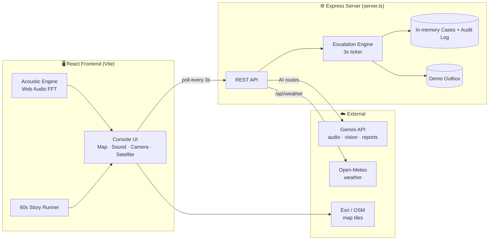
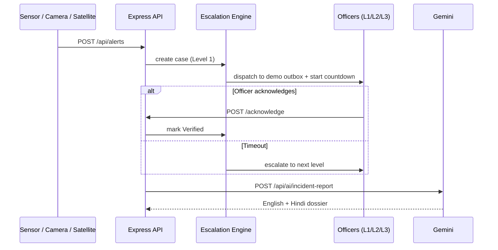
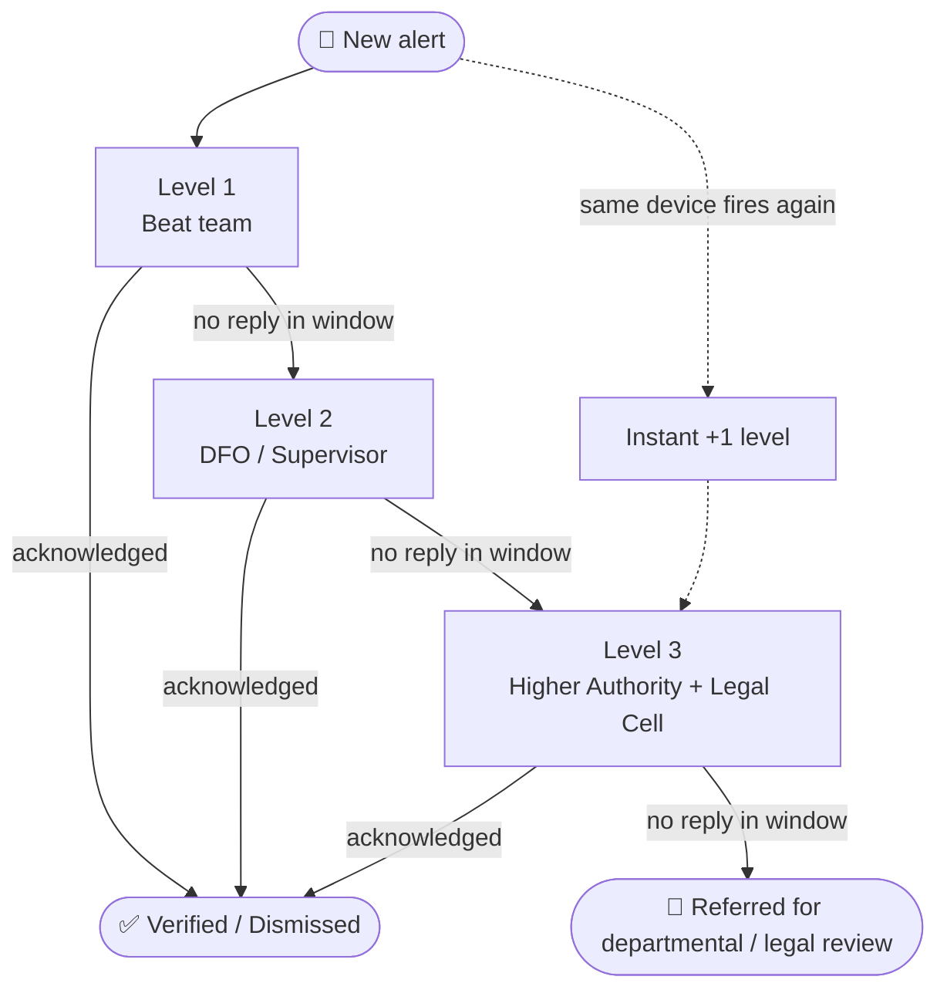

<div align="center">

# 🌲 GreenGuard — The Aravalli Watch

**Detect early. Alert responsibly. Protect forests.**


</div>

---

## 📖 Table of Contents
1. [Problem](#-problem)
2. [Solution](#-solution)
3. [Features](#-features)
4. [Real vs Simulated](#-real-vs-simulated-honesty-by-design)
5. [Architecture](#-architecture)
6. [How Escalation Works](#-how-escalation-works)
7. [60-Second Demo Story](#-60-second-demo-story)
8. [Tech Stack](#-tech-stack)
9. [Project Structure](#-project-structure)
10. [API Reference](#-api-reference)
11. [Setup & Run](#-setup--run)
12. [Screenshots](#-screenshots)
13. [Roadmap](#-roadmap)
14. [Disclaimer](#-disclaimer)

---

## 🧩 Problem
The **Aravalli range** (Rajasthan, India) protects groundwater, wildlife and nearby cities from desert spread. But illegal tree-cutting, mining, fires and encroachment are often noticed **too late**, and when an alert is ignored, nobody knows *who* ignored it.

## 💡 Solution
GreenGuard is an **early warning + escalation system**. Sensors and AI spot a possible threat, a **human always makes the final call**, and if nobody responds, the alert automatically moves **up the chain of authority** with a full audit trail.

> AI is only a helper. It never accuses a person. A human must verify before any action.

---

## ✨ Features

| Feature | What it does |
|---|---|
| 🔊 **Sound Warning** | Listens to the mic (Web Audio FFT) and flags chainsaw (1.8–3.2 kHz) and axe-hit patterns (200–750 Hz). |
| 📷 **Camera Photo Checker** | Gemini Vision inspects a photo/camera frame for fire, smoke, cleared land. People are anonymized as *"a person is present"*. |
| 🛰️ **Satellite Alerts** | Simulated Sentinel-2 NDVI tree-cover change detection through a real REST API. |
| 🗺️ **Forest Map** | Satellite + street maps (Leaflet), place search, click-to-pin coordinates. |
| ⏱️ **Escalation Engine** | 3 levels with reply countdowns, auto-escalation on timeout, instant escalation on repeat hits. |
| ✅ **Human Decision Queue** | Officer verifies or dismisses each alert. |
| 📝 **AI Incident Report** | Neutral, bilingual (English + Hindi) report with full audit trail. |
| 👥 **Citizen Form** | Community observations, stored only in the user's browser. |
| 📮 **Demo Outbox** | All "SMS/Email" go to a visible demo outbox. Nothing is really sent. |
| 🌐 **EN / हिंदी** | Full language toggle. |

---

## 🔍 Real vs Simulated (Honesty by Design)

| Capability | Status | Details |
|---|---|---|
| Acoustic detection | ✅ Real (on device) | FFT rules run in the browser, audio stays local |
| Deep audio classification | ✅ Real (optional) | Gemini, only on explicit click |
| Camera vision | ✅ Real (optional) | Gemini Vision with privacy rules |
| Weather | ✅ Real | Open-Meteo regional model for Udaipur (not an in-forest sensor) |
| Map tiles | ✅ Real | Esri World Imagery + OpenStreetMap |
| Escalation engine + audit log | ✅ Real logic | Rules, timers, CSV export |
| Incident reports | ✅ Real (optional) | Gemini, factual and non-accusatory |
| Satellite change detection | 🧪 Simulated | Mock data behind a real API |
| SMS / Email / Radio dispatch | 🧪 Simulated | `QUEUED_IN_DEMO_OUTBOX` only |
| Citizen reports | 💾 Local only | Browser `localStorage` |

> No Gemini key? The app still works with on-device fallbacks, so the demo never breaks.

---

## 🏗️ Architecture



### Data flow of one alert



---

## 🚨 How Escalation Works



**Rules**
- Every level has a reply timer (30 s, 60 s or 300 s).
- Timeout → the alert moves up and the lower office's **inaction is logged**.
- **Repeat detection** from the same device → instant escalation, no waiting.
- Every step is saved in a tamper-evident **audit trail** (exportable as CSV).

---

## 🎬 60-Second Demo Story

Click **▶ Play 60-Second Example Story** in the top bar.

| Step | What happens |
|---|---|
| 1 | Node `ACOUSTIC-NOD-4B` hears a chainsaw-like sound |
| 2 | Alert goes to the Level 1 beat team, countdown starts |
| 3 | Nobody replies → auto-escalates to Level 2 (DFO) |
| 4 | Second sound from the same node → jumps to Level 3 |
| 5 | Officer enters ground-verification notes |
| 6 | Gemini writes the English + Hindi incident report |

<div align="center"></div>

---

## 🧰 Tech Stack

| Layer | Tools |
|---|---|
| Frontend | React 19, TypeScript, Vite, Tailwind CSS 4, Motion, Recharts, Lucide |
| Maps | Leaflet, Esri World Imagery, OpenStreetMap |
| Backend | Node.js, Express, `tsx` |
| AI | Google Gemini via `@google/genai` |
| Audio | Web Audio API (FFT) |
| Weather | Open-Meteo |

---

## 📂 Project Structure

```
aravalli-forest-watch/
├── server.ts               # Express API, escalation engine, Gemini routes
├── src/
│   ├── App.tsx             # App shell, polling, modals
│   ├── types.ts            # Shared types
│   ├── translations.ts     # English / Hindi text
│   ├── audio/
│   │   └── acousticEngine.ts   # FFT chainsaw/axe detection
│   ├── demo/
│   │   └── storyRunner.ts      # 60-second story automation
│   └── components/
│       ├── PageEntry / PageWhyForests / PageConsole   # 3 pages
│       ├── MapPanel · AcousticPanel · CameraPanel · SatellitePanel
│       ├── EscalationPanel · ReviewQueuePanel · CommunityFormPanel
│       └── ArchitectureModal · AccuracyDrawer · DemoOutboxModal · IncidentReportModal
├── docs/assets/            # README images
├── .env.example
└── package.json
```

---

## 🔌 API Reference

| Method | Endpoint | Purpose |
|---|---|---|
| GET | `/api/escalations` | All cases + outbox |
| POST | `/api/alerts` | Create alert (or escalate on repeat) |
| POST | `/api/escalations/:id/acknowledge` | Officer acknowledges |
| POST | `/api/escalations/:id/status` | Update case status |
| POST | `/api/escalations/reset-demo` | Reset demo data |
| POST | `/api/ai/audio-analysis` | Gemini audio classification |
| POST | `/api/ai/vision-analysis` | Gemini image analysis |
| POST | `/api/ai/incident-report` | Bilingual incident report |
| GET | `/api/weather` | Udaipur weather (Open-Meteo) |

---

## 🚀 Setup & Run

**Requirements:** Node.js 18+

```bash
# 1. Clone
git clone https://github.com/<your-username>/aravalli-forest-watch-project.git
cd aravalli-forest-watch-project

# 2. Install
npm install

# 3. Environment (optional but recommended)
cp .env.example .env
# add your key:  GEMINI_API_KEY="your-key"

# 4. Run
npm run dev
```

Open (https://aravalli-forest-watch-project.onrender.com/) 🎉

| Variable | Required | Purpose |
|---|---|---|
| `GEMINI_API_KEY` | Optional | AI audio, vision and reports. Without it, fallbacks are used. |
| `PORT` | Optional | Default `3000` |

**Other commands:** `npm run build` · `npm run lint`

> 🎤 Allow **microphone/camera** permission in the browser to try Sound Warning and Camera Checker.

---

## 🖼️ Screenshots

| Landing | Console (demo running) |
|---|---|
|  |  |

---

## 🛣️ Roadmap
1. **Edge acoustic model** — CNN on ESP32-S3 / Raspberry Pi via ONNX.
2. **LoRaWAN mesh** — solar nodes for ridges with no mobile network.
3. **Live Sentinel-2** — real NDVI change from Copernicus data.
4. **Authority portals** — SSO and official ticketing integration.

---

## ⚠️ Disclaimer
GreenGuard is a **demo prototype**. It is not affiliated with any government body, does not send real messages, and does not identify or accuse individuals. Alerts need **human verification** before any action.

<div align="center">

**Made with 💚 for the Aravalli**

</div>
